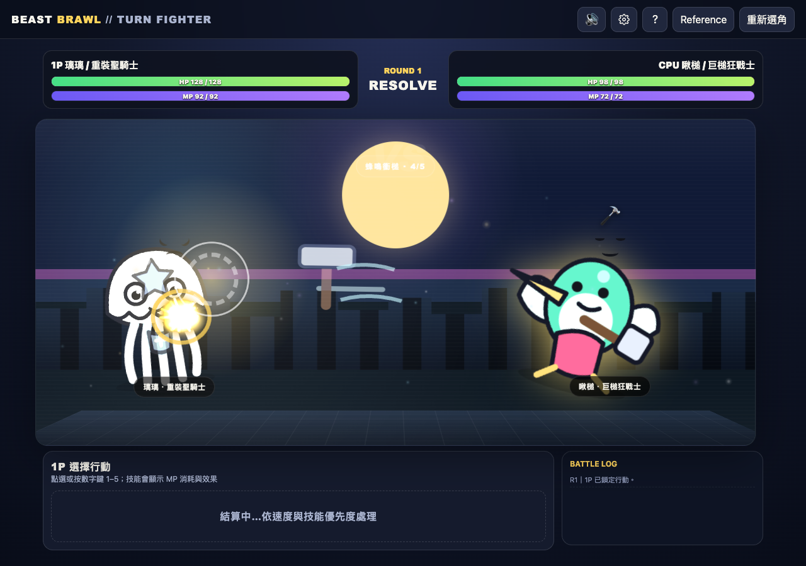
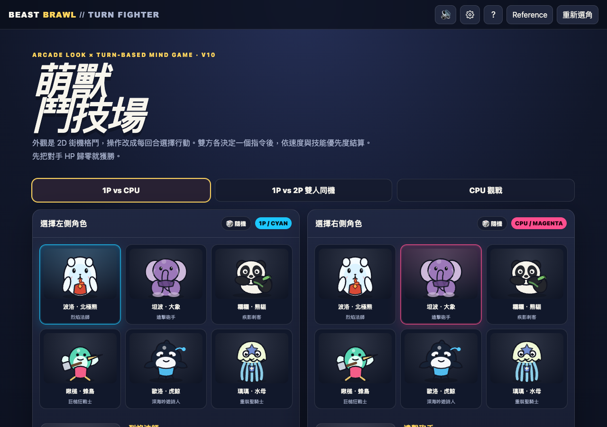
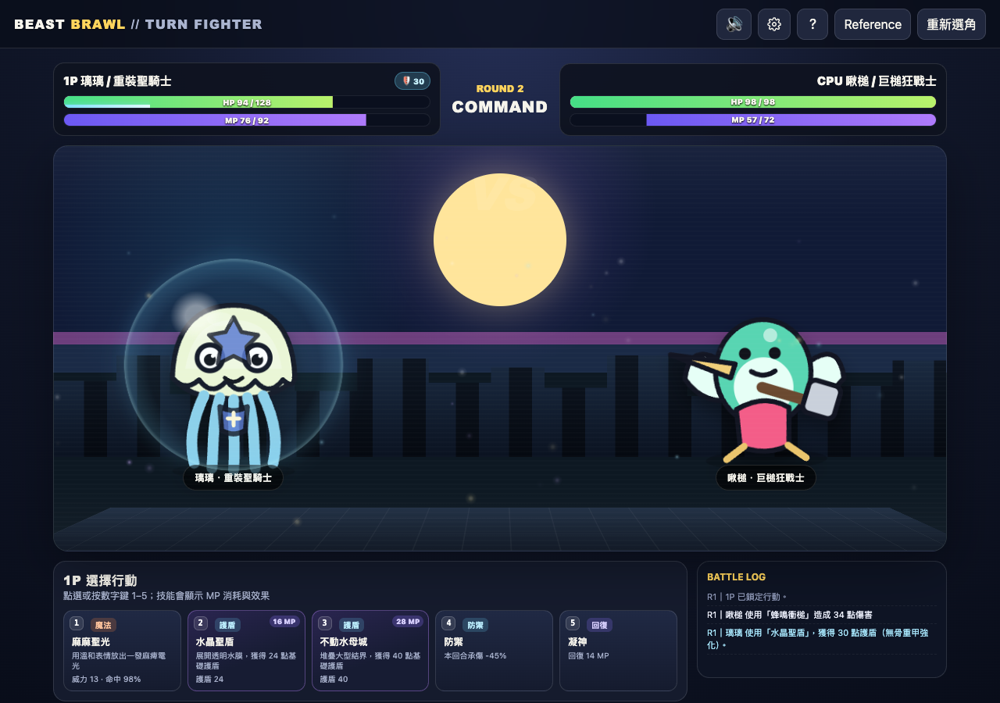

<div align="center">

# 萌獸鬥技場 · Beast Brawl

**回合制指令 × 街機格鬥演出的網頁對戰遊戲**
Turn-based mind games, arcade-fighter presentation — runs in any modern browser, zero install.

[](https://github.com/xdxd-lab/beast_fighter/actions/workflows/ci.yml)


### ▶ [立即遊玩 xdxd-lab.github.io/beast_fighter](https://xdxd-lab.github.io/beast_fighter/)



</div>

## 目錄

- [特色](#特色)
- [快速開始](#快速開始)
- [操作方式](#操作方式)
- [遊戲規則](#遊戲規則)
- [角色一覽](#角色一覽)
- [設定與網址參數](#設定與網址參數)
- [技術架構](#技術架構)
- [開發與測試](#開發與測試)
- [效能](#效能)
- [瀏覽器支援](#瀏覽器支援)
- [部署](#部署)
- [版本紀錄與授權](#版本紀錄與授權)

## 特色

| 面向 | 內容 |
| --- | --- |
| 玩法 | 六名角色、各兩套異色造型；1P vs CPU、1P vs 2P 雙人同機、CPU 觀戰三種模式 |
| 演出 | 每個動作 5 個姿勢 × 32 格補間、必殺技全螢幕 cut-in、命中停頓（hit-stop）、依招式輕重調整震動 |
| 特效 | Canvas 粒子系統（加色混合與半透明光暈）、15 種技能各自的命中特效、半透明護盾泡泡、六角防禦結界、低血量暈影、勝利彩帶、場景漂浮微粒 |
| 音訊 | 全部以 Web Audio 即時合成：介面音、15 種技能施放／命中音、選角與戰鬥 BGM、勝利音樂；有混音匯流排、殘響、壓縮與限幅 |
| 介面 | 延遲扣血 HP 條、護盾條與狀態標籤、附快捷鍵與 MP 不足提示的指令卡、能力值條、技能預覽、戰果統計 |
| 無障礙 | 全程可用鍵盤操作、對話框焦點管理、`aria-live` 戰鬥紀錄、遵循「減少動態效果」系統設定 |
| 觸控 | 觸控漣漪與多點編號回饋（沿用 MultiTouchKit `mtk-viewer` 的視覺風格），手機版面最窄支援 390 px |
| 工程 | 純邏輯戰鬥引擎與畫面分離、可重現的亂數種子、Node 單元測試＋無頭瀏覽器端到端測試、GitHub Actions CI |
| 部署 | 無建置步驟、無外部套件、無音檔與圖片下載；GitHub Pages 直接提供靜態檔案，下載後也能離線遊玩 |

<table>
  <tr>
    <td></td>
    <td></td>
  </tr>
  <tr>
    <td align="center">角色選擇</td>
    <td align="center">對戰 HUD 與指令卡</td>
  </tr>
</table>

## 快速開始

**線上遊玩**：開啟 <https://xdxd-lab.github.io/beast_fighter/> 即可，不需要安裝。

**本機執行**：

```bash
git clone https://github.com/xdxd-lab/beast_fighter.git
cd beast_fighter
python3 -m http.server 8000   # 然後開啟 http://localhost:8000
```

也可以直接用瀏覽器開啟 `index.html`。所有腳本都是傳統 `<script src>`，不使用 ES modules 或 `fetch`，因此 `file://` 也能正常運作。

**離線遊玩**：在 GitHub 按 **Code → Download ZIP**，解壓後開啟 `index.html`。V10 起程式拆成多個檔案，請保留整個資料夾，不要只複製 `index.html`。

## 操作方式

| 動作 | 滑鼠／觸控 | 鍵盤 |
| --- | --- | --- |
| 選角 | 點選角色卡 | <kbd>Tab</kbd> 移到角色區，方向鍵切換 |
| 開始對戰／再戰 | 點 **FIGHT!**／**REMATCH** | <kbd>Enter</kbd> |
| 選擇指令 | 點指令卡 | <kbd>1</kbd>–<kbd>5</kbd> |
| 失衡時繼續 | 點「失衡中」 | <kbd>Enter</kbd> |
| 靜音 | 🔊 | <kbd>M</kbd> |
| 設定／說明 | ⚙／? | <kbd>S</kbd>／<kbd>?</kbd> |
| 關閉對話框 | 點背景或按鈕 | <kbd>Esc</kbd> |

雙人同機時，1P 鎖定指令後畫面會切換給 2P；2P 選擇期間 1P 請先不要偷看。

## 遊戲規則

- **回合流程**：雙方各選一個指令，依速度決定先後。速度 = 基礎 SPD − 減速懲罰 3 ＋ 0–3 的隨機值；「防禦」額外 +20，所以一定先發動。速度相同時 1P 先。
- **傷害**：`威力 + ATK × 0.72 + (−2～+3) − DEF × 0.63`，最低 3 點。魔法只計算 32% 防禦，貫穿只計算 20%。暴擊 ×1.5，基本暴擊率 8%。
- **防禦**：本回合承受的傷害降為 55%。
- **護盾**：先吸收傷害，可以疊加。
- **MP**：特殊技能消耗 MP；「凝神」回復 14 MP（不超過上限）。
- **狀態**：攻↓（ATK −20%）與速↓（SPD −3）持續兩回合；失衡的一方下回合無法行動。
- **勝負**：先把對手 HP 歸零的一方獲勝。

所有數值都定義在 [`js/data/roster.js`](js/data/roster.js) 與 [`js/core/engine.js`](js/core/engine.js) 的 `RULES` 常數中，並由單元測試鎖定。

## 角色一覽

| 角色 | 職業 | HP | MP | ATK | DEF | SPD | 被動 |
| --- | --- | ---: | ---: | ---: | ---: | ---: | --- |
| 波洛・北極熊 | 烈焰法師 | 104 | 118 | 12 | 7 | 9 | HP 低於 50% 時傷害 +12% |
| 坦波・大象 | 遠擊砲手 | 138 | 78 | 13 | 12 | 5 | 專屬技能傷害 +8% |
| 糰糰・熊貓 | 疾影刺客 | 96 | 94 | 16 | 6 | 18 | 本回合先行動時傷害 +12% |
| 啾槌・蜂鳥 | 巨槌狂戰士 | 98 | 72 | 19 | 5 | 13 | HP 低於 35% 時傷害 +18% |
| 歐洛・虎鯨 | 深海吟遊詩人 | 122 | 108 | 10 | 9 | 9 | 「凝神」額外回復 6 HP |
| 璃璃・水母 | 重裝聖騎士 | 128 | 92 | 9 | 14 | 6 | 護盾效果 +25% |

每名角色有一招免 MP 的基本技與兩招專屬技，另外共用「防禦」與「凝神」。

## 設定與網址參數

遊戲內的 ⚙ 設定會存在瀏覽器的 `localStorage`；如果瀏覽器封鎖儲存空間，會改用預設值。

| 設定 | 選項 | 預設 |
| --- | --- | --- |
| 主音量／音樂／音效 | 0–100% | 80% / 60% / 85% |
| 全部靜音 | 開／關 | 關 |
| 戰鬥速度 | 1× / 1.5× / 2× | 1× |
| 特效品質 | 自動 / 高 / 省電 | 自動（偵測到掉幀時自動降為省電） |
| 減少動態效果 | 跟隨系統 / 開 / 關 | 跟隨系統 |

給展示與自動化測試使用的網址參數：

| 參數 | 說明 | 範例 |
| --- | --- | --- |
| `mode` | `cpu`、`local`、`demo`（CPU 觀戰） | `?mode=demo` |
| `autostart=1` | 載入後直接開打 | `?mode=demo&autostart=1` |
| `seed` | 固定亂數種子，重現同一場戰鬥 | `?seed=42` |
| `speed` | 覆寫戰鬥速度：`1`、`1.5`、`2`、`4` | `?speed=2` |
| `mute=1` | 停用所有音訊 | `?mute=1` |

## 技術架構

```
index.html               頁面結構、SEO／分享用 meta、對話框
css/main.css             版面、動畫、特效、品質與減少動態的 CSS 開關
js/core/settings.js      設定存取（含驗證與儲存失敗時的退路）
js/data/roster.js        角色與技能資料（UMD，瀏覽器與 Node 共用）
js/core/engine.js        純邏輯戰鬥引擎：回合順序、傷害、狀態、勝負、CPU AI、可設種子的 RNG
js/render/sprites.js     角色 SVG 與 5 格 × 32 步技能特效圖
js/audio/audio.js        Web Audio 合成器、音效庫、BGM 音序器、混音
js/fx/particles.js       Canvas 粒子系統與自動品質調整
js/fx/touch.js           觸控／點擊漣漪
js/main.js               控制器：畫面、對戰演出、HUD、輸入、對話框
tests/                   Node 單元測試（node:test，無相依套件）
scripts/qa/              無頭 Chrome 端到端測試、素材產生、音量量測（只用 Python 標準函式庫）
```

設計重點：

- **規則與演出分離**：`Engine.resolveAction()` 先算出結果，控制器再依結果播放動畫。規則可以單獨測試，換掉畫面也不會改到平衡。
- **戰鬥生命週期**：每場戰鬥是一個 `BattleSession`，所有延遲都透過它排程。離開或重開時會一次取消，舊的流程不會碰到新的一場（V9 在結算中按「重新選角」會發生這個問題）。
- **時間軸**：動作在 `requestAnimationFrame` 時間軸上播放，支援命中停頓與戰鬥倍速；分頁切到背景再回來時，會直接跳到動作結尾，不會補播。

詳見 [docs/ARCHITECTURE.md](docs/ARCHITECTURE.md) 與 [docs/AUDIO.md](docs/AUDIO.md)。

## 開發與測試

不需要安裝任何套件。

```bash
npm test                              # Node 18+：引擎單元測試（34 項）
python3 scripts/qa/smoke_test.py      # 無頭 Chrome 端到端測試
python3 scripts/qa/audio_check.py     # 離線渲染音樂與音效，量測 300 Hz 以上響度，輸出 WAV 試聽檔到 .qa/audio
python3 scripts/qa/render_assets.py   # 重新產生 favicon、分享預覽圖與 README 截圖
```

端到端測試會檢查：角色選擇正常顯示；固定種子的 CPU 觀戰能打到結算畫面；只用鍵盤能打完一場 1P 對戰；結算中重開不會殘留上一場；沒有 console 錯誤；390 px 寬度沒有水平捲軸。找不到 Chrome 時，可以用 `CHROME=/path/to/chrome` 指定。

GitHub Actions（`.github/workflows/ci.yml`）在每次 push 到 `main` 與每個 PR 時執行上述兩套測試，並把截圖上傳為 artifact。

## 效能

在 headless Chrome 中，以同一組種子跑同一段固定指令的雙人對戰（8 個動作），比較 V9 與 V10：

| 指標 | V9 | V10 | 變化 |
| --- | ---: | ---: | ---: |
| 建立的 DOM 節點 | 3,401 | 1,516 | −55% |
| Layout 次數 | 388 | 290 | −25% |

主要做法：

- 動作改在 rAF 時間軸播放，不再串接 32 個計時器。
- 特效 SVG 與濾鏡改成常駐節點，不再每格重建。
- 姿勢 class 只在改變時才更新。
- HP 與 MP 條改用 `transform` 動畫。
- 移除全舞台的 `mix-blend-mode`、`backdrop-filter` 與多重 `drop-shadow`。
- 粒子使用物件池與預先繪製的光暈貼圖，閒置或分頁隱藏時自動停止。
- 戰鬥紀錄最多保留 80 筆。

Paint 與 Raster 時間在 headless 環境下雜訊太大，沒有列入比較。

## 瀏覽器支援

自動化測試在 Chrome（桌面與 390 px 行動版模擬）上執行。程式只使用 Firefox、Safari、Edge 現行版本也支援的標準 API：Web Audio、Canvas 2D、Web Animations、CSS `aspect-ratio`，Safari 另外加上 `-webkit-backdrop-filter`。不支援 Web Audio 的環境仍可正常遊玩，只是沒有聲音。

## 部署

GitHub Pages 設定為 **Deploy from a branch → `main` / (root)**。合併到 `main` 後會自動更新 <https://xdxd-lab.github.io/beast_fighter/>，沒有建置步驟。`.nojekyll` 讓 Pages 直接提供靜態檔案。

## 版本紀錄與授權

- 版本紀錄：[CHANGELOG.md](CHANGELOG.md)
- 授權：本儲存庫目前**尚未附授權條款**，在加入 `LICENSE` 之前，著作權由作者保留。
- 設計參考：介面只參考「左右對峙、HP 資源條、角色異色、街機式演出」等高層概念。所有角色 SVG、音效與音樂皆為原創，並在程式執行時產生。完整說明請見遊戲內的 **Reference** 按鈕。
